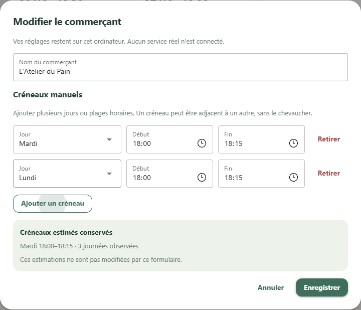

# Roro 3.0

Un projet Python familial pour étudier les disponibilités de paniers, proposer des
créneaux de suivi et démontrer un parcours de réservation robuste **sur données fictives**.

Cette version livre un cœur modulaire, une démonstration locale configurable et les
invariants de sécurité. Aucun compte réel, token ou accès à une plateforme n'est nécessaire.
Il ne contient ni client Too Good To Go, ni connexion Telegram, ni paiement.

Le projet met en pratique une architecture modulaire, des modèles typés, des migrations
SQLite, des tests de concurrence et une interface locale indépendante de la logique métier.

## État du projet — version 0.3.0

| Jalon livré | Fonctionnalités disponibles | Tests automatisés |
| --- | --- | --- |
| 0.1 — Socle | Configuration, SQLite, simulation, arrêt global et protection contre les doublons | 73 réussis |
| 0.2 — Commerçants | Ajout et édition, horaires manuels/estimés, sélection du suivi et persistance | 121 réussis |
| 0.3 — Planification | Observation dans les créneaux, fréquence configurable, démarrage explicite et affichage des passages | 164 réussis |

La version courante est validée localement, sur une installation séparée et par
[GitHub Actions](https://github.com/Laetitia-Bara/Roro3/actions/runs/40711361602).
Les essais d'interface couvrent les passages automatiques, les arrêts, la non-reprise
au redémarrage et plusieurs onglets sans doublon. [Détail des validations](docs/VALIDATION.md).

La prise en main dans VS Code a également confirmé le démarrage et l'arrêt du suivi,
l'arrêt global, ainsi que la conservation des réglages sans reprise automatique après
redémarrage. Le troisième jalon est validé ; l'étape suivante porte sur la consultation
de l'historique et l'explication des estimations.

Tout fonctionne sur le simulateur. Les contrôles planifiés font uniquement de
l'observation, sans notification ni réservation. La couverture statistique avancée,
les notifications planifiées et toute intégration réelle restent hors de cette version.

Ce README est actualisé à chaque jalon livré et testé : fonctionnalités disponibles,
installation, utilisation, validations et limites. Les étapes de prise en main sont
décrites dans les documents de jalon, sans publier de données personnelles.



[Voir le tableau de bord actuel](docs/images/scheduler-dashboard.png) ·
[Architecture](docs/ARCHITECTURE.md) · [Validation](docs/VALIDATION.md)

## Installation reproductible — Windows / PowerShell

Prérequis : Git et Python. La version vérifiée est Python **3.14.4 sur Windows x64**.
Le projet déclare Python 3.12 à 3.14 ; les autres versions de cette plage et les autres
systèmes ne sont pas encore validés. Le fichier de verrou inclut le cœur, l'interface
optionnelle et les outils de test.

```powershell
git clone https://github.com/Laetitia-Bara/Roro3.git
cd Roro3
python -m venv .venv
.\.venv\Scripts\python.exe -m pip install -r requirements-lock.txt
.\.venv\Scripts\python.exe -m pip install --no-deps -e .
.\.venv\Scripts\python.exe -m roro3 ui
```

L'interface s'ouvre sur `http://127.0.0.1:8080`, uniquement sur l'ordinateur local.
`Ctrl+C` arrête son serveur. Aucun compte, token ou fichier `.env` n'est nécessaire
pour cette démonstration. Ne pas réutiliser de configuration issue d'un compte réel.

Pour installer seulement le cœur et les tests, sans NiceGUI :

```powershell
.\.venv\Scripts\python.exe -m pip install -e ".[dev]"
.\.venv\Scripts\python.exe -m roro3 demo
```

Cette seconde méthode utilise les plages de versions du projet ; pour reproduire
l'environnement vérifié complet, préférer le fichier `requirements-lock.txt`.

## Utiliser VS Code

Après l'installation, ouvrir **le dossier Roro3 cloné** avec **Fichier → Ouvrir le dossier**.
Sur l'installation locale d'origine, ce dossier est `D:\Roro3` ; le projet peut être cloné
ailleurs sans modifier la configuration VS Code.

- **Lancer l'application** : ouvrir **Exécuter et déboguer** (`Ctrl+Maj+D`), choisir
  **Roro3 : lancer l'application**, puis appuyer sur **F5**. Le navigateur s'ouvre sur
  `http://127.0.0.1:8080`. Le carré rouge ou `Maj+F5` arrête l'application.
- **Tester** : ouvrir le panneau **Tests** (icône éprouvette), puis **Exécuter tous les
  tests**. Une autre possibilité est de sélectionner **Roro3 : tests automatiques**
  dans les configurations de lancement, puis **F5**.

Les extensions Python et Python Debugger sont recommandées par le projet. Si VS Code
demande un interpréteur, choisir `.venv\Scripts\python.exe` dans le dossier Roro3.
Une sélection d'interpréteur déjà mémorisée par VS Code peut devoir être corrigée avec
**Python: Select Interpreter**.

Le lancement utilise le module de l'application, quel que soit le fichier ouvert dans
l'éditeur. Si le port 8080 est déjà occupé par une instance de Roro3, arrêter cette
instance avant de relancer. [Documentation officielle du débogage VS Code](https://code.visualstudio.com/docs/python/debugging),
[panneau de tests Python](https://code.visualstudio.com/docs/python/testing).

## Démonstration

Le jeu initial comprend trois commerces inventés, deux paniers disponibles, un historique
fictif de trois mardis et des fenêtres manuelles/estimées. La CLI utilise une horloge fixe au 27 octobre 2026
pour rendre les résultats reproductibles. Aucun contrôle périodique ne démarre tout seul.
L'écran propose un cycle manuel et une surveillance planifiée, activée explicitement.

## Commerçants et créneaux

Dans l'interface, **Ajouter un commerçant** ouvre un formulaire avec un nom et autant
de plages jour/début/fin que nécessaire. Un commerçant peut être enregistré sans horaire.
Les plages du même jour ne doivent ni se chevaucher ni traverser minuit. Une erreur
laisse le formulaire ouvert ; **Annuler** ne sauvegarde rien.

**Modifier** permet de renommer le commerçant et d'éditer ses horaires manuels. Les
créneaux estimés restent distincts et ne sont jamais écrasés par le formulaire.
**Recalculer les estimations** actualise ces derniers à partir de l'historique disponible.

**Suivre ce commerçant** sélectionne les commerces inclus dans les prochains contrôles.
**Désactiver** conserve le commerce, ses horaires et tout son historique, mais empêche
son suivi ; **Réactiver** retrouve son choix de suivi précédent. Ces réglages sont
persistants et ne lancent jamais un cycle tout seuls. Un commerce inconnu, désactivé
ou non suivi est également bloqué à la frontière de réservation, indépendamment de l'écran.

Le catalogue fictif prend en compte les ajouts sans redémarrage. Les identifiants et les
créneaux de retrait restent stables pour une même journée, même après un renommage ou
un redémarrage. L'écran suit la date courante ; la CLI conserve son scénario fixe.
[Parcours et limites du deuxième jalon](docs/JALON_02_COMMERCANTS.md).

## Surveillance planifiée simulée

Le bloc **Surveillance planifiée** ajoute une observation automatique des commerçants
actifs et suivis, uniquement pendant leurs créneaux manuels ou estimés.

1. Activer **Observer les disponibilités** et vérifier que l'arrêt global est levé.
2. Choisir une fréquence entre **15 et 3 600 secondes** (60 par défaut), puis
   **Enregistrer la fréquence**.
3. Cliquer sur **Démarrer la surveillance**. L'écran indique le prochain contrôle,
   le dernier passage et les éventuelles erreurs.
4. Utiliser **Arrêter la surveillance**, **Arrêt global** ou arrêter le serveur pour terminer.

Les passages planifiés font de l'**observation seule** : aucune notification ni commande,
même si les options du cycle manuel autorisent une réservation fictive. Un commerçant
sans horaire, désactivé ou non suivi n'est pas contrôlé par le planificateur. Les créneaux
qui se recouvrent ne provoquent pas de double passage.

L'app ne reprend pas la surveillance au lancement. L'arrêt global et la désactivation
d'Observation la désarment ; les lever ne suffit pas à la relancer. La fréquence et
les derniers passages sont conservés pour respecter la cadence après un redémarrage.

**Le serveur lancé dans VS Code doit rester actif.** Fermer seulement l'onglet du
navigateur ne l'arrête pas. Un seul moteur sert tous les onglets ; une seconde instance
sur la même base ne peut pas prendre la surveillance déjà active.
[Fonctionnement et essai guidé du troisième jalon](docs/JALON_03_PLANIFICATION.md).

```powershell
.\.venv\Scripts\python.exe -m roro3 demo --database data\autre-demo.sqlite3
.\.venv\Scripts\python.exe -m roro3 stop
.\.venv\Scripts\python.exe -m roro3 status
.\.venv\Scripts\python.exe -m roro3 resume
```

La politique par défaut observe, sans notification de disponibilité ni réservation,
avec `dry_run=true`. Même en activant la réservation et en désactivant dry-run dans
l'interface, seules des commandes **fictives** peuvent être produites. Un dry-run
n'appelle aucune méthode de réservation ; il peut écrire un aperçu dans l'historique.

Pour les cycles manuels, les interrupteurs observation, notification et réservation sont indépendants. Si une
notification ou réservation fictive est activée, les relevés nécessaires enrichissent
également l'historique. Les comptes rendus de tentative restent affichés même si les
notifications de disponibilité sont désactivées. L'arrêt global est conservé dans SQLite
et ne se désactive pas au redémarrage. Il bloque les nouvelles actions admises ; une
action déjà admise ne constitue pas une annulation et reste suivie.

## Configuration et confidentialité

Copier `.env.example` vers `.env` pour personnaliser les variables locales. La CLI charge
ce fichier du dossier courant sans remplacer les variables d'environnement existantes.
La politique d'environnement initialise une **nouvelle base** ; l'état d'une base déjà
créée fait autorité. Les fichiers privés et bases sont exclus de Git.

Ne jamais copier les configurations ou l'historique Git des anciennes applications.
Les bases, sessions, clés privées, journaux et sauvegardes doivent rester hors du dépôt.
Un `.gitignore` n'efface pas un secret déjà présent dans l'historique.
Voir [les règles de sécurité](docs/SECURITE.md).

## Architecture et tests

Le cœur utilise des modèles typés, SQLite et des contrats simples. L'interface NiceGUI
est un adaptateur optionnel. [Architecture, limites et prochaines étapes](docs/ARCHITECTURE.md).

```powershell
.\.venv\Scripts\python.exe -m pytest
.\.venv\Scripts\python.exe -m ruff check .
```

Les tests couvrent les modes sans action, le dry-run, l'arrêt persistant, les doublons
au redémarrage et en concurrence, les résultats inconnus, l'historique, la migration
SQLite, l'édition des commerçants, leur sélection et la validation des horaires.
Aucun test n'envoie de commande externe. La démonstration se teste avec le réseau bloqué.
La suite actuelle comporte **164 tests**, réussis localement sur Windows et sur une
installation séparée du paquet. Le workflow GitHub Actions exécute pytest et Ruff à
chaque envoi ; son résultat reste consultable dans l'onglet **Actions** du dépôt.

## Limites du jalon

La planification fonctionne tant que le serveur local tourne ; aucun service système
permanent n'est installé. Les estimations sont descriptives, sans taux de probabilité : la couverture
complète des jours surveillés reste à modéliser. Une disponibilité observée peut provenir
d'une remise en vente ; elle n'est pas une heure de publication exacte. Les premiers
relevés déjà disponibles ne sont pas utilisés comme transitions pour les estimations.

Le suivi des annulations, expirations et états distants n'est pas implémenté : aucune
plateforme réelle n'est connectée. Les conditions de Too Good To Go interdisent l'extraction
automatisée ; une intégration réelle n'est pas promise et nécessiterait un mécanisme
autorisé. [Conditions officielles, article 7.5](https://www.toogoodtogo.com/fr/legal/terms-and-conditions-using-the-app).

Ce projet est destiné à un usage familial et à une démonstration portfolio Python.
Aucun service commercial ou déploiement public n'est configuré. Le choix de licence
de réutilisation n'est pas encore arrêté ; aucun code du client tiers n'est recopié.
