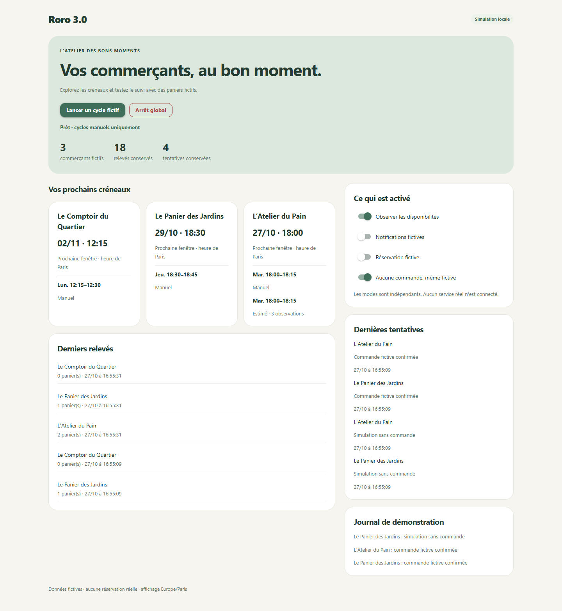

# Interface locale de Roro 3.0

## Choix du premier jalon

NiceGUI est retenu comme interface **optionnelle** pour cette première démonstration. Le cœur Python et les commandes locales fonctionnent sans ce paquet. L'import de NiceGUI est limité au point d'entrée de `roro3.ui`, au moment où l'interface est demandée.

L'interface reprend les idées utiles de Roland : cartes par commerçant, verts sauge et fond crème, échéance suivante, horaires manuels ou estimés, états visibles et commandes courtes. La version actuelle présente les données fictives et les états persistants ; elle ne prétend pas fournir une automatisation en arrière-plan.

## Alternatives examinées

| Solution | Avantages pour Roro | Compromis |
| --- | --- | --- |
| NiceGUI | Écrans écrits en Python, composants interactifs, mise en page responsive ; cœur métier réutilisé directement | Dépendances supplémentaires et petit serveur local ; le navigateur doit rester disponible |
| Tkinter | Inclus dans les distributions Python qui fournissent Tk ; fenêtre de bureau sans serveur HTTP | Une interface moderne et adaptative demanderait davantage de travail de présentation |
| Flutter | Écran Roland déjà existant, potentiel mobile | Deux langages et une liaison au cœur Python à maintenir pour un projet centré sur Python |

Le choix NiceGUI vise ce petit projet local et pourra être réévalué sans modifier les services métier. Il ne nécessite ni hébergement ni compte externe. [Présentation officielle NiceGUI](https://nicegui.io/), [documentation Tkinter](https://docs.python.org/3/library/tkinter.html), [documentation Flutter](https://docs.flutter.dev/).

## Comportement de la démonstration

- Lancer un cycle reste une action manuelle. Aucun minuteur ne lance de détection ou réservation en arrière-plan.
- Les interrupteurs Observation, Notifications et Réservation fictive sont indépendants et enregistrés en base.
- « Aucune commande, même fictive » correspond au mode `dry_run`. Il bloque les créations de commande dans le connecteur simulé.
- L'arrêt global conserve les modes choisis, mais empêche les nouveaux cycles. Reprendre le suivi n'exécute aucun cycle automatiquement.
- Toutes les disponibilités, notifications et réservations sont fictives. Aucun token ou service Telegram réel n'est utilisé.
- Les créneaux sont affichés dans le fuseau Europe/Paris. Les valeurs estimées restent distinctes des horaires saisis.

## Exposition réseau et ressources

Le serveur écoute explicitement sur `127.0.0.1`. Le partage NiceGUI On Air est désactivé, comme le rechargement automatique. Les styles sont embarqués et les polices proviennent du système ; aucune police distante, image distante ou script ajouté depuis un CDN n'est employé par Roro3. Les composants de NiceGUI sont servis par l'installation locale. [Paramètres officiels de lancement](https://nicegui.io/documentation/run).

Cette liaison locale évite de rendre l'écran accessible aux autres appareils du réseau. L'interface n'est pas conçue pour un déploiement public ou multi-utilisateur ; les protections nécessaires à un tel usage ne font pas partie de ce jalon.

## Limites assumées

Pas de formulaire complet de configuration, d'édition des commerçants, de connexion réelle, ni de surveillance permanente dans cette première interface. Les prochaines évolutions pourront être ajoutées aux services existants après validation de ce squelette et de ses tests.

## Vérification du premier écran

Contrôle effectué le 27 octobre 2026 avec un navigateur Edge sans fenêtre, piloté par Playwright, sur le serveur local de démonstration. Toutes les requêtes de page vers des hôtes extérieurs à `127.0.0.1` ou `localhost` étaient bloquées pendant le contrôle ; aucune requête extérieure n'a été tentée et aucune erreur JavaScript n'a été observée.

Parcours vérifiés dans l'interface réelle :

- Observation seule : trois relevés ajoutés, aucune tentative de réservation.
- Réservation fictive activée avec « Aucune commande, même fictive » : deux aperçus enregistrés et aucune commande confirmée.
- Désactivation de cette dernière protection : deux commandes fictives confirmées ; les aperçus restent distincts.
- Nouveau cycle sur les mêmes paniers : le nombre de tentatives reste à quatre, dont deux confirmations ; pas de réservation fictive en double.
- Arrêt global : bouton de cycle désactivé, modes inchangés. Reprise : aucun cycle lancé automatiquement.
- Rechargement de la page : modes persistants conservés. État final remis à Observation active, Notifications et Réservation fictive désactivées, protection « Aucune commande » active, arrêt global désactivé.
- Affichage à 1440 pixels puis à 390 pixels : cartes lisibles, aucun débordement horizontal à 390 pixels.

Les essais utilisent seulement la base et le connecteur de démonstration. Ils ne valident aucun service externe.

