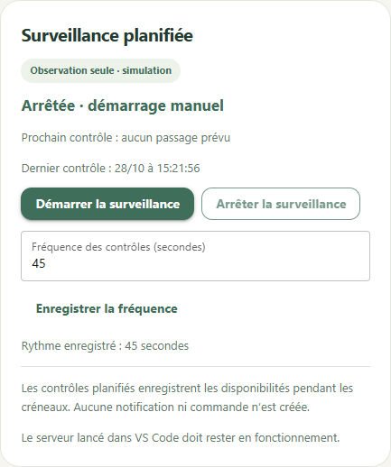

# Troisième jalon — surveillance planifiée simulée

## Essai guidé dans VS Code

1. Relancer **Roro3 : lancer l'application** avec F5 pour charger la nouvelle version.
2. Modifier un commerçant fictif suivi : ajouter pour aujourd'hui une plage commençant
   un peu avant l'heure actuelle et finissant quelques minutes plus tard.
3. Dans **Surveillance planifiée**, régler temporairement la fréquence à 15 secondes
   et l'enregistrer. Vérifier qu'Observation est activée et l'arrêt global levé.
4. Cliquer sur **Démarrer la surveillance**. Les relevés apparaissent sans utiliser
   le bouton de cycle manuel ; le prochain et le dernier passage sont affichés.
5. Cliquer sur **Arrêter la surveillance** : aucun nouveau passage n'est admis.
   Remettre ensuite la fréquence habituelle, 60 secondes par défaut.

Les créneaux restent des heures de Paris. Leur début est inclus et leur fin exclue.
Les fenêtres traversant minuit restent hors périmètre. Les recommandations estimées
sont utilisées comme les fenêtres manuelles, sans compter deux fois un recouvrement.

## Fonctionnement

Un seul moteur est attaché au serveur de l'app. Ouvrir plusieurs onglets ne multiplie
pas les contrôles. Les pages actualisent les statuts et les relevés sans rechargement,
en conservant les formulaires et les saisies de fréquence ouverts.

Les commerçants doivent être actifs, suivis et dans un créneau. Les changements sont
relus avant le prochain passage. Sans commerçant dû, aucun appel au simulateur n'est
effectué. Un même contrôle partagé peut relever plusieurs commerçants dus.

La fréquence se règle entre 15 et 3 600 secondes et est persistante. Le dernier passage
admis de chaque commerçant est aussi conservé : arrêter puis redémarrer n'autorise pas
de passage anticipé. Après un échec, la prochaine tentative respecte le même rythme.

La planification fait seulement de l'observation. Elle ne notifie ni ne réserve, même
si les options manuelles autorisent une réservation fictive. Les fonctions manuelles
existantes ne sont pas modifiées par un démarrage ou un arrêt de la planification.

## Arrêt et redémarrage

**Arrêter la surveillance** désarme la planification sans modifier les modes manuels.
**Arrêt global** la désarme également et bloque les autres actions. Réactiver le suivi
global ou Observation ne redémarre pas la planification : il faut cliquer sur Démarrer.

Le serveur doit tourner dans VS Code. Fermer uniquement l'onglet du navigateur laisse
la surveillance demandée continuer. Maj+F5 arrête le serveur et sa session ; F5 ne la
relance pas. Après un arrêt brutal ou une pause prolongée du débogueur, une session
peut rester visible quelques secondes avant d'expirer. Un clic sur Arrêter permet
aussi de la désarmer ; le redémarrage reste explicite.

Une session exclusive en base empêche deux processus de prendre simultanément la même
surveillance. Un contrôle déjà admis peut terminer pendant l'arrêt ; l'app ne prétend
pas annuler rétroactivement une action en cours. Aucun service système ni tâche Codex
planifiée n'est installé.

## Vérifications

Les tests utilisent une horloge virtuelle et de vraies transactions SQLite, sans
attente ni accès réseau. Ils vérifient les fenêtres de Paris et les changements d'heure,
la cadence, les recouvrements, les sélections modifiées, les migrations et la concurrence.
Les mêmes tests bloquent explicitement notifications et réservations dans ce parcours.

La version `0.3.0` comporte 164 tests. Les captures et essais d'interface utilisent une
base de démonstration distincte ; aucune donnée locale de l'utilisateur n'est publiée.

Les essais dans un vrai navigateur ont confirmé les passages automatiques, la cadence
avec deux onglets, la conservation d'un formulaire ouvert et d'une fréquence non
enregistrée. Les commerçants en pause, sans horaire ou hors créneau sont ignorés.
Arrêter la surveillance bloque les nouveaux passages ; lever l'arrêt global ne la
relance pas. Un contrôle continue bien après fermeture de tous les onglets si le serveur
tourne encore. La fréquence enregistrée est conservée au rechargement.

Les modes manuels de notification et réservation étaient volontairement actifs dans la
base de contrôle : les passages planifiés n'ont créé aucune notification ni tentative.
Aucune requête externe ni erreur JavaScript observée. Le journal serveur ne montre pas
d'erreur applicative ; deux réinitialisations de transport Windows ont été observées
lors de fermetures de navigateur, sans effet sur les données.

[Vue du tableau de bord de contrôle](images/scheduler-dashboard.png).
